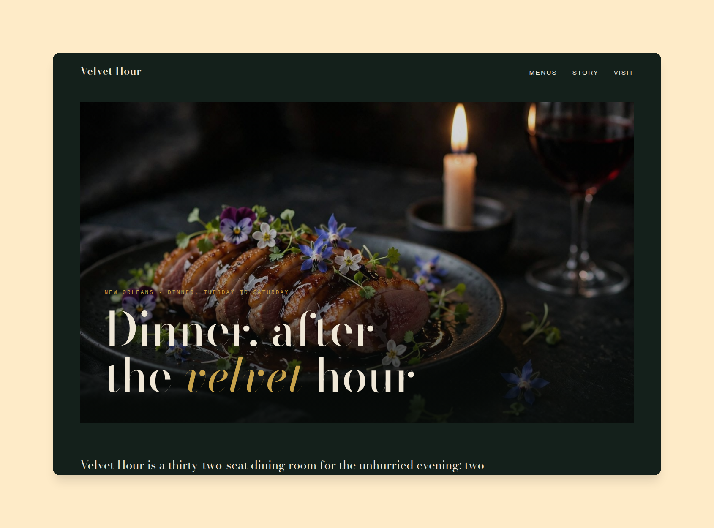
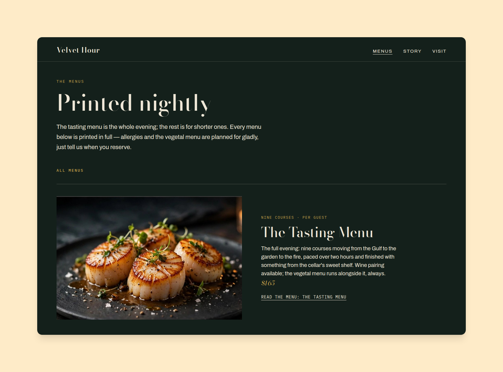
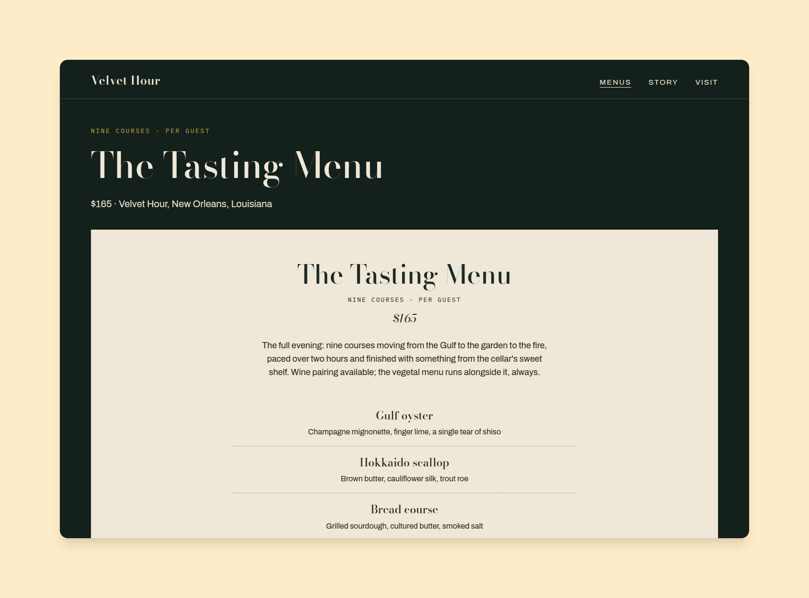
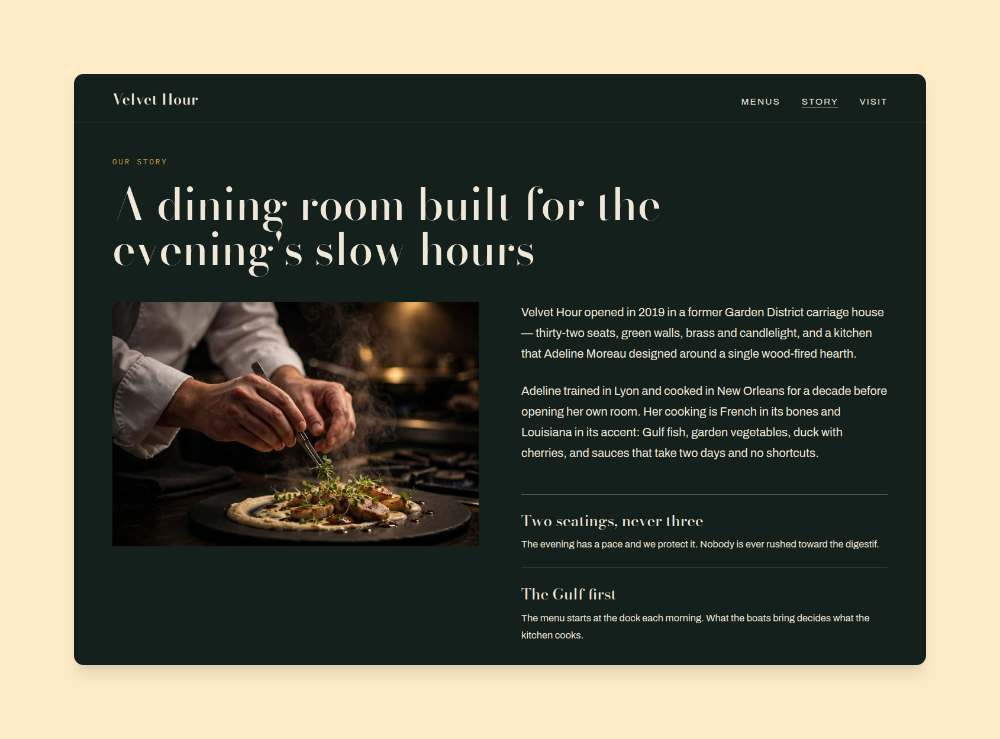
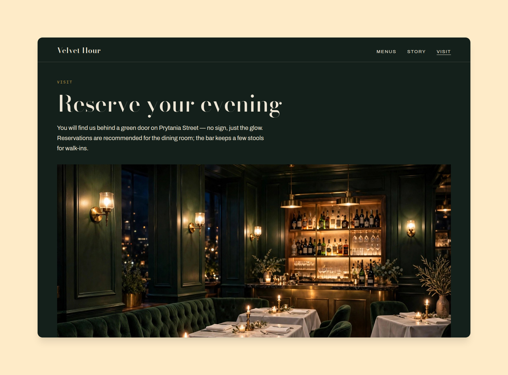
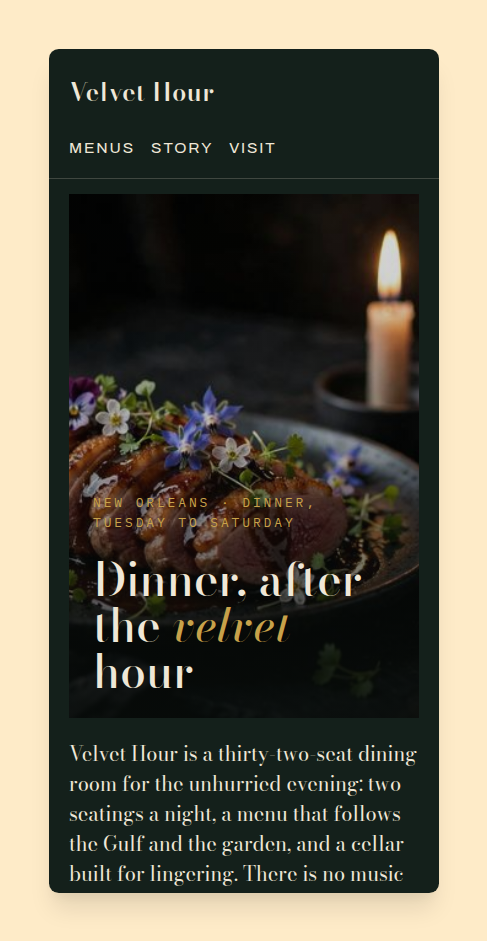

# Velvet Hour

A fine-dining restaurant template — Astro 7 + SST v3 (S3 + CloudFront).
A deep green-black ground, bone-white Didone display type, muted gold
accents, and menus presented the way they're printed: on bone-colored
paper, course by course. Hand-built components, no UI framework.



**Live preview:** https://ctrimm.github.io/velvet-hour/

Demo brand: **Velvet Hour**, a fictional thirty-two-seat restaurant in
New Orleans — two seatings a night, nine courses on the tasting menu,
and a four-hundred-bottle cellar. Every word of it is placeholder copy
in one file, waiting for yours.

## Screenshots

All framed with PrettySnap on the same warm cream background.








## In motion

The micro-interactions, recorded live: load-in, hero drift, row and
photo hovers, and a click through to a detail page.


Full-quality video: [motion.mp4](screenshots/motion/motion.mp4)

## Make it yours (one file)

Open **`site.config.ts`** — it is the only file you need to edit:

- Restaurant name, email, location, founded year, credit line
- Social links
- Colors and the font preset (contrast-safe combinations are checked
  in the test suite)
- Home: eyebrow, giant hero headline (mark a word with `*asterisks*`
  for the gold italic), hero photo, manifesto, stat counters
- The experiences, "an evening hour by hour," and the press quotes
- **The menus** — title, price, note, photo, summary and the full
  course list; each menu gets its own page (and an entry in the
  sitemap and llms.txt) automatically
- Story page: photo, paragraphs, principles, booking note
- Visit page: photo, address, hours and seatings, good-to-know notes

The config is validated at build time. A typo — a bad email, a
duplicate slug, a hex color missing its `#` — stops the build with a
plain-language explanation of exactly what to fix.

## Pages

| Page      | What it is                                                        |
| --------- | ----------------------------------------------------------------- |
| Home      | Candlelit hero over the signature dish, manifesto + stats, experiences index, three featured menus, the evening hour by hour, press quotes, reservation CTA |
| Menus     | Every menu as a photo card, plus the experiences in detail with item chips |
| Menu page | The menu printed on bone paper: note, price, summary, every course, reserve CTA, next-menu link |
| Story     | Chef photo, the restaurant's story, three principles, press      |
| Visit     | The dining room, address, hours & seatings, good-to-know notes   |

Plus `/llms.txt` (a plain-text map of the site for AI assistants),
schema.org `Restaurant` JSON-LD, `/sitemap.xml`, and an AI-welcoming
`robots.txt`.

## Imagery

All photography is AI-generated for this template (originals in
`source-images/`) — no stock photos, nothing to license. Regenerate
responsive variants after replacing a photo with:

```bash
python3 scripts/optimize-images.py
```

Fonts are self-hosted woff2 (Bodoni Moda, Archivo, IBM Plex Mono) —
no Google Fonts requests at runtime.

## Develop

```bash
npm install
npm run dev          # local preview
npm test             # unit + integration (rebuilds dist)
npm run test:e2e     # Playwright against the built site
npm run grade        # Lighthouse on the main routes
npm run build        # production build → dist/
```

## Deploy

This template has two ways out the door:

- **Production (SST → your own AWS):** `npm run deploy` — static site
  on S3 + CloudFront. Yours to run, on your account.
- **Preview (GitHub Pages):** the included workflow builds with
  `BASE=/velvet-hour` and publishes to
  `https://<owner>.github.io/velvet-hour/`. The template is
  subpath-safe: every internal link, image, font and srcset is prefixed
  from the same `BASE` value, and an integration suite builds the whole
  site that way to prove it.

## Tests

158 tests: config validation (including computed WCAG contrast ratios
for the shipped palette), slug/routing helpers, config ↔ on-disk image
integrity, full build output for every page, the subpath Pages build,
and Playwright end-to-end flows. Lighthouse (run locally, reported in
CI): Accessibility, Best Practices and SEO at 100 on every graded
route; Performance 92–99 locally.

## License

MIT
